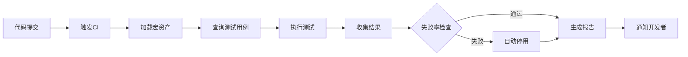

# 宏测试规范与黄金样例格式

## 1. 概述

本文档定义宏资产的测试规范、黄金样例格式和CI校验流水线。

**对应任务**: F1.2 宏资产CI校验流水线  
**草案依据**: D11 + F类功能扩展

---

## 2. 黄金样例（Golden Test Cases）

### 2.1 定义

黄金样例是经过人工验证的、预期行为正确的测试用例，用于：
- 回归测试（确保宏修改后行为不变）
- 自动化验证（CI流水线中自动执行）
- 文档示例（展示宏的正确用法）

### 2.2 黄金样例结构

```json
{
  "testCaseId": "tc_xxxxxxxx-xxxx-xxxx-xxxx-xxxxxxxxxxxx",
  "macroId": "macro_yyyyyyyy-yyyy-yyyy-yyyy-yyyyyyyyyyyy",
  "name": "查询北京天气",
  "description": "测试查询北京当日天气的完整流程",
  "testType": "golden",
  "priority": "high",
  "isGolden": true,
  "initialState": {
    "screenState": "home_screen",
    "appState": "idle",
    "connectivity": "wifi"
  },
  "inputParameters": {
    "location": "北京",
    "date": "today"
  },
  "expectedResult": {
    "status": "success",
    "data": {
      "location": "北京",
      "temperature": "*",
      "condition": "*"
    }
  },
  "expectedUiState": {
    "topActivity": "com.example.weatherapp/.MainActivity",
    "visibleElements": [
      "temperature_text",
      "condition_icon"
    ]
  },
  "timeoutMs": 10000,
  "createdAt": 1709654400000
}
```

### 2.3 字段说明

| 字段 | 类型 | 必需 | 说明 |
|------|------|------|------|
| `testCaseId` | string | 是 | 测试用例唯一ID |
| `macroId` | string | 是 | 关联的宏ID |
| `name` | string | 是 | 测试用例名称 |
| `description` | string | 否 | 详细描述 |
| `testType` | string | 是 | smoke/functional/regression/golden |
| `priority` | string | 是 | high/medium/low |
| `isGolden` | boolean | 是 | 是否为黄金样例 |
| `initialState` | object | 否 | 初始状态（屏幕、应用、网络等）|
| `inputParameters` | object | 否 | 输入参数 |
| `expectedResult` | object | 是 | 预期结果（支持通配符*）|
| `expectedUiState` | object | 否 | 预期UI状态 |
| `timeoutMs` | integer | 是 | 超时时间（毫秒）|

---

## 3. 测试类型

### 3.1 Smoke Test（冒烟测试）
- **目的**: 快速验证基本功能可用
- **运行频率**: 每次代码提交
- **覆盖范围**: 核心路径（Happy Path）

### 3.2 Functional Test（功能测试）
- **目的**: 验证功能正确性
- **运行频率**: 每次发布前
- **覆盖范围**: 所有功能点

### 3.3 Regression Test（回归测试）
- **目的**: 确保修改未破坏已有功能
- **运行频率**: 每次代码修改后
- **覆盖范围**: 黄金样例集

### 3.4 Golden Test（黄金测试）
- **目的**: 建立基准行为
- **运行频率**: 定期（每日/每周）
- **覆盖范围**: 关键业务流程

---

## 4. 测试结果

### 4.1 结果类型

| 结果 | 说明 |
|------|------|
| `pass` | 测试通过 |
| `fail` | 测试失败（断言不匹配）|
| `timeout` | 执行超时 |
| `error` | 执行异常（如崩溃）|
| `skip` | 跳过执行 |

### 4.2 测试结果示例

```json
{
  "testCaseId": "tc_12345678",
  "macroId": "macro_87654321",
  "result": "fail",
  "executionTimeMs": 8234,
  "failureReason": "Expected result mismatch",
  "failedStepIndex": 3,
  "expectedValue": "{\"temperature\": 25}",
  "actualValue": "{\"temperature\": null}",
  "screenshotRef": "/sdcard/test_screenshots/tc_12345678.png",
  "uiSnapshotRef": "/sdcard/test_snapshots/tc_12345678.json",
  "testedAt": 1709654500000
}
```

---

## 5. CI 校验流水线

### 5.1 流水线阶段



### 5.2 自动停用策略

宏资产在以下情况下自动停用：

1. **连续失败**: 连续 ≥3 次测试失败
2. **高失败率**: 样本数 ≥5 且失败率 ≥70%

停用后自动回灌到 A8.1 AssetLibrary，标记为 `disabled` 状态。

### 5.3 流水线配置

```yaml
# ci-config.yaml
pipeline:
  name: "Macro Asset Validation"
  version: "1.0.0"
  
trigger:
  - on_commit
  - on_schedule:
      cron: "0 2 * * *"  # 每天凌晨2点
  
stages:
  - name: "Load Macros"
    action: "query_all_macros"
    
  - name: "Run Tests"
    action: "run_all_tests"
    parallel: true
    timeout: 300000  # 5分钟
    
  - name: "Check Failure Rate"
    action: "check_auto_disable"
    thresholds:
      consecutive_failures: 3
      failure_rate: 0.7
      min_samples: 5
      
  - name: "Generate Report"
    action: "export_report"
    formats:
      - json
      - html
      - junit_xml
      
  - name: "Notify"
    action: "send_notification"
    channels:
      - email
      - webhook

reports:
  output_dir: "/sdcard/genton/test_reports"
  retention_days: 30
```

---

## 6. 黄金样例创建流程

### 6.1 手动创建

```bash
# 1. 录制宏
adb shell am broadcast -a com.genton.macro.START_RECORDING

# 2. 执行操作序列
# (用户手动操作)

# 3. 停止录制
adb shell am broadcast -a com.genton.macro.STOP_RECORDING \
  --es sessionId "session_xxx"

# 4. 生成宏
adb shell am broadcast -a com.genton.macro.GENERATE \
  --es sessionId "session_xxx" \
  --es name "查询天气" \
  --es description "查询北京天气"

# 5. 注册黄金样例
adb shell am broadcast -a com.genton.macro.REGISTER_TEST_CASE \
  --es macroId "macro_xxx" \
  --es testCase "$(cat golden_test.json)"
```

### 6.2 从现有宏创建

```json
{
  "macroId": "macro_12345678",
  "name": "回归测试：查询天气",
  "testType": "golden",
  "priority": "high",
  "isGolden": true,
  "expectedResult": {
    "status": "success"
  },
  "timeoutMs": 10000
}
```

---

## 7. 验证规则

### 7.1 结果验证

支持以下验证方式：

1. **精确匹配**: `"temperature": 25`
2. **通配符**: `"temperature": "*"` (任意值)
3. **范围验证**: `"temperature": {"min": 0, "max": 40}`
4. **正则表达式**: `"condition": {"regex": "晴|多云"}`
5. **存在性**: `"data": {"exists": true}`

### 7.2 UI状态验证

```json
{
  "expectedUiState": {
    "topActivity": "com.example.weatherapp/.MainActivity",
    "visibleElements": [
      "temperature_text",
      "condition_icon"
    ],
    "notVisibleElements": [
      "loading_spinner"
    ],
    "elementProperties": {
      "temperature_text": {
        "text": {"regex": "\\d+°C"}
      }
    }
  }
}
```

---

## 8. 测试报告格式

### 8.1 JSON 报告

```json
{
  "generatedAt": 1709654600000,
  "format": "json",
  "summary": {
    "totalMacros": 10,
    "testedMacros": 8,
    "passedMacros": 6,
    "failedMacros": 2,
    "disabledMacros": 1
  },
  "macros": [
    {
      "macroId": "macro_12345678",
      "macroName": "查询天气",
      "totalTests": 3,
      "passed": 2,
      "failed": 1,
      "status": "fail"
    }
  ]
}
```

### 8.2 JUnit XML 报告

```xml
<?xml version="1.0" encoding="UTF-8"?>
<testsuites>
  <testsuite name="macro_12345678" tests="3" failures="1">
    <testcase name="冒烟测试" classname="macro_12345678">
      <failure message="Expected result mismatch"></failure>
    </testcase>
    <testcase name="功能测试" classname="macro_12345678"/>
  </testsuite>
</testsuites>
```

---

## 9. 最佳实践

### 9.1 黄金样例设计

1. **独立性**: 每个测试用例应独立可执行，不依赖其他用例
2. **可重复**: 测试结果应稳定，避免随机性
3. **有意义**: 测试用例应覆盖真实业务场景
4. **最小化**: 每个测试专注一个功能点

### 9.2 测试数据管理

1. 使用模拟数据（Mock Data）避免外部依赖
2. 为每个测试准备干净的初始状态
3. 测试完成后清理环境

### 9.3 失败处理

1. 失败后立即通知相关开发者
2. 保留失败时的截图和UI快照
3. 记录详细的失败日志

---

## 10. 工具支持

### 10.1 CLI 工具

见 `genton-macro-test` 命令行工具

### 10.2 SDK 集成

```kotlin
// 在测试代码中使用
val testCase = MacroTestCase(
    macroId = "macro_12345678",
    name = "查询天气测试",
    testType = "golden",
    expectedResult = """{"status": "success"}""",
    timeoutMs = 10000
)

val result = macroValidationService.runTestCase(testCase.testCaseId)
assertEquals("pass", result.result)
```

---

## 11. 示例文件

见附录：
- `golden-test-example.json` - 黄金样例模板
- `ci-pipeline-config.yaml` - CI配置示例
